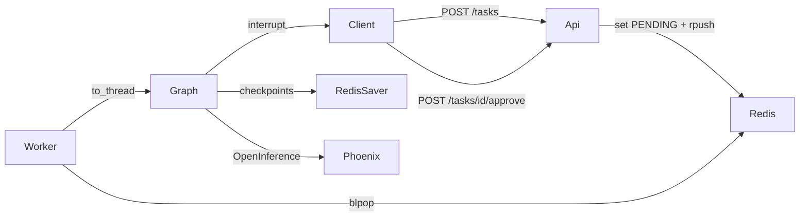

# API del orquestador, con Redis, Phoenix y aprobación humana

`POST /tasks` encola la consulta y devuelve un `job_id` al instante. Un worker corre el orquestador del módulo 6 (supervisor, investigador, analista y síntesis), guarda el estado del job en Redis y los checkpoints del grafo en `RedisSaver`. Si la tarea pide una herramienta con efectos secundarios, o si el costo estimado pasa un límite, el grafo se pausa con `interrupt` hasta `POST /tasks/{id}/approve`. Cada ejecución es una traza en Arize Phoenix, enviada por OpenInference.



## Quick path

> **Requisito: Python 3.12 o superior.** `app/graph.py` declara `type Orquestador = CompiledStateGraph[...]`, el alias `type` de PEP 695, que no existe antes de 3.12. `main.py`, `app/main.py` y `app/worker.py` llaman a `exigir_python_312()` antes de importar el grafo. Con 3.11 el mensaje sale antes del `SyntaxError` (`evidencias/03-python-311.txt`).

**Windows (PowerShell):**

```powershell
py -3.12 -m venv .venv
Set-ExecutionPolicy -Scope Process -ExecutionPolicy Bypass
.\.venv\Scripts\Activate.ps1
pip install -r requirements.txt
Copy-Item .env.example .env
```

**Linux/macOS:**

```bash
python3.12 -m venv .venv
source .venv/bin/activate
pip install -r requirements.txt
cp .env.example .env
```

> **En cada terminal nueva**, antes de `python ...`, activá el venv. La activación (y `Set-ExecutionPolicy -Scope Process`) vale solo para esa terminal:
>
> - Windows: `Set-ExecutionPolicy -Scope Process -ExecutionPolicy Bypass` y `.\.venv\Scripts\Activate.ps1`
> - Linux/macOS: `source .venv/bin/activate`
>
> El prompt empieza con `(.venv)`. Sin activar, usá el intérprete del venv directo: `.\.venv\Scripts\python.exe main.py` (Windows) o `.venv/bin/python main.py`.

En `.env` cargá `LLM_PROVIDER=openai` y `OPENAI_API_KEY` (con `gpt-4o-mini` Phoenix calcula el costo), y `REDIS_URL=redis://localhost:6379`. `PINECONE_API_KEY` es opcional: si queda vacía, la búsqueda híbrida corre en memoria. `.env` no se versiona.

### 1. Redis

Redis 8, porque `RedisSaver.setup()` crea índices con RediSearch y RedisJSON:

```text
docker run -d --name redis-preentrega-7 -p 6379:6379 redis:8
```

### 2. Phoenix

En otra terminal, con el venv activado (ver la nota de arriba):

```text
python -m phoenix.server.main serve
```

El dashboard queda en http://localhost:6006, y el colector, en `http://localhost:6006/v1/traces`. El proyecto se llama `preentrega-7`.

### 3. La API

En otra terminal, con el venv activado (ver la nota de arriba):

```text
python main.py
```

Con `WORKER_IN_API=1` (el default), el worker corre dentro de la API. Para separarlo, poné `WORKER_IN_API=0` en la API y, en otra terminal con el venv activado, corré `python -m app.worker`. Así lo arma el compose.

### Todo junto con Docker Compose

```text
docker compose up --build
```

Levanta cuatro servicios: Redis 8, Phoenix, la API con `WORKER_IN_API=0` y el worker como proceso propio (`python -m app.worker`). La corrida contra el compose está en `evidencias/08-compose.txt`.

### Chequeo sin clave y sin Redis

Con el venv activado:

```text
python validacion.py
python -m pytest -q
py -3.11 main.py
```

`validacion.py` y `pytest` no llaman a la API ni abren Redis. El doble del modelo está en `tests/conftest.py`, y el de la demo, en `validacion.py`.

## Probar una tarea

**Windows (PowerShell):**

```powershell
curl.exe -X POST localhost:8000/tasks -H "Content-Type: application/json" -d "{\"query\": \"¿Cuántos días de vacaciones corresponden con 5 años de antigüedad?\"}"
curl.exe localhost:8000/tasks/<job_id>
```

**Linux/macOS:**

```bash
curl -X POST localhost:8000/tasks -H "Content-Type: application/json" -d '{"query": "¿Cuántos días de vacaciones corresponden con 5 años de antigüedad?"}'
curl localhost:8000/tasks/<job_id>
```

El POST vuelve enseguida con `job_id`, `thread_id` y `"status": "PENDING"`. El GET no corre el agente, solo lee Redis. El ciclo es `PENDING`, `RUNNING` y `DONE`. Si el worker lanza una excepción, el job queda `FAILED` con el mensaje en `error`, y el cliente deja de esperar.

## Hilos de conversación

Para seguir una conversación, mandá el `thread_id` de una tarea anterior:

```bash
curl -X POST localhost:8000/tasks -H "Content-Type: application/json" -d '{"query": "¿Y cuántos días acumula en total en esos 5 años?", "thread_id": "<thread_id>"}'
curl localhost:8000/threads/<thread_id>
```

El checkpointer es `RedisSaver`, con `thread_id` en `configurable`. `messages` acumula la conversación del hilo. Lo propio de cada turno (contribuciones, pasos, tokens y aprobaciones) se reinicia con `Overwrite`. El supervisor, la síntesis y los especialistas reciben la conversación previa, así que una pregunta de seguimiento llega con su tema.

`GET /threads/{thread_id}` lee el historial desde los checkpoints. Como está en Redis, sobrevive a un reinicio de la API (`evidencias/07-redis.txt`). Un hilo que ya tiene un job en curso no acepta otro: responde 409.

La demo, con la API levantada, en otra terminal con el venv activado:

```text
python demo_api.py hilo
```

## Cinco peticiones concurrentes

Con Redis, Phoenix y la API levantados, en otra terminal con el venv activado:

```text
python carga.py
python metricas.py
python capturas.py carga
```

`carga.py` borra el proyecto `preentrega-7` de Phoenix, así el p95 no mezcla trazas viejas. Después manda 5 `POST /tasks` a la vez, comprueba que vuelven en menos de un segundo con cinco `job_id` distintos y espera a que las cinco tareas queden en `DONE`. `metricas.py` le pide a Phoenix, por su endpoint GraphQL, lo que Phoenix calculó: el p95, el costo de cada traza y los tokens y la latencia por nodo. `capturas.py` saca las capturas con Playwright usando el Chrome instalado.

Cada ejecución es una sola traza `orquestador`, con `session.id` igual al `thread_id`. La telemetría nativa de FastAPI excluye `/tasks` y `/threads`: si no, cada GET del polling sería una traza de 2 ms que entraría en el p95 y en el costo por traza.

## Lectura del dashboard

Estos números corresponden a la corrida de `evidencias/04-carga.txt`, leídos de Phoenix en `evidencias/05-metricas.txt`:

| Métrica | Valor (calculado por Phoenix) |
| --- | --- |
| Trazas | 5, una por ejecución |
| Latencia p95 | 11,24 s (p50 9,49 s, p99 11,59 s) |
| Costo por ejecución | 0,000448 a 0,000794 USD, con una media de 0,000591 USD |
| Costo de la corrida | 0,002953 USD: 13847 tokens de entrada y 1764 de salida |

Por nodo, el investigador gasta el 52% de los tokens (8161) y el 39% de la latencia de nodos. Hace modelo, búsqueda híbrida y modelo, y los fragmentos de política que recupera entran como contexto. El supervisor es el segundo, con el 34% de los tokens y el 35% de la latencia: corre 13 veces en 5 ejecuciones, porque decide antes y después de cada especialista. El analista solo interviene cuando la pregunta pide una cuenta (3 de 5 veces) y gasta el 5%.

Lo que más bajaría costo y p95 es achicar el contexto del investigador (menos fragmentos o fragmentos más cortos) y ahorrar la primera decisión del supervisor. Sin aportes, la guarda ya obliga a buscar antes de cerrar, así que esa llamada casi nunca cambia la ruta.

Con el compose, la misma corrida dio un p95 de 13,97 s (`evidencias/08-compose.txt`).

Una corrección que se ve en los números: con `OpenAIInstrumentor` y `LangChainInstrumentor` juntos, cada llamada aparecía dos veces, como `ChatOpenAI` y como `ChatCompletion`, y Phoenix duplicaba los tokens y el costo. Por eso `app/observability.py` instrumenta solo LangChain. `tests/test_observabilidad.py::test_langchain_instrumentado_y_openai_no` lo exige.

## Aprobación humana

Hay dos razones para pausar:

- **Efecto secundario.** Si la consulta pide registrar un ajuste de nómina, el supervisor manda al nodo `aprobacion` antes de `register_payroll_adjustment`. El GET pasa a `AWAITING_APPROVAL` y el `interrupt` dice `"reason": "side-effect tool register_payroll_adjustment"`.
- **Costo muy alto.** Cada nodo suma los tokens que gastó (`get_usage_metadata_callback`). Si el costo estimado con el precio de `gpt-4o-mini` pasa `COSTO_MAXIMO_USD` (por defecto 0,01 USD), el supervisor pausa con `"reason": "estimated cost above COSTO_MAXIMO_USD"`, `estimated_cost_usd` y `limit_usd`.

```powershell
curl.exe -X POST localhost:8000/tasks/<job_id>/approve -H "Content-Type: application/json" -d "{\"approved\": true}"
```

El endpoint está en `app/hitl.py`, junto al nodo. Con `approved: true`, el grafo reanuda: corre la herramienta, o sigue trabajando si la pausa fue por costo. Con `approved: false`, reanuda y cierra sin el paso pausado, y la respuesta final dice que se rechazó. El approve también vuelve al instante, con `"status": "RUNNING"`.

La demo, con la API levantada, en otra terminal con el venv activado:

```text
python demo_api.py hitl
python demo_api.py pausar
```

La pausa vive en el checkpoint de Redis. Si dejás una tarea en `AWAITING_APPROVAL` (`python demo_api.py pausar`), reiniciás la API y corrés `python demo_api.py aprobar`, el approve igual reanuda el grafo y la tarea llega a `DONE`.

## Archivos

| Artefacto | Dónde está |
| --- | --- |
| `POST /tasks`, `GET /tasks/{id}`, `GET /threads/{thread_id}` | `app/main.py` |
| `TaskRequest`, `TaskResponse`, `TaskStatus`, `ThreadHistory` | `app/main.py` |
| Orquestador del módulo 6, `RedisSaver`, guarda de costo | `app/graph.py` |
| Worker `PENDING` / `RUNNING` / `AWAITING_APPROVAL` / `FAILED` / `DONE`, `python -m app.worker` | `app/worker.py` |
| OpenInference, `LangChainInstrumentor`, decorador `trace_llm` | `app/observability.py` |
| `interrupt`, `POST /tasks/{id}/approve`, `register_payroll_adjustment` | `app/hitl.py` |
| Investigador, analista, RAG | `agents/`, `rag.py`, `data/` |
| Familias de error del modelo | `errors.py`, `modelo.py` |
| Cinco POST concurrentes | `carga.py` |
| Métricas de Phoenix | `metricas.py` |
| Capturas del dashboard | `capturas.py`, `screenshots/` |
| Demo contra la API real (HITL, hilos, reinicio) | `demo_api.py` |
| Demo sin clave | `validacion.py` |
| Tests | `tests/` |
| Redis 8 + Phoenix + API + worker | `docker-compose.yml`, `Dockerfile` |

## Estados

| Estado | Cuándo |
| --- | --- |
| `PENDING` | El POST ya escribió Redis y encoló. Todavía no corre el grafo. |
| `RUNNING` | El worker tomó el job, o acaba de entrar un approve. |
| `AWAITING_APPROVAL` | El grafo está pausado en `interrupt`. Hace falta `POST /tasks/{id}/approve`. |
| `DONE` | Terminó. `result` es la respuesta. |
| `FAILED` | El worker capturó la excepción, y `error` dice qué pasó. |

El `set` de `PENDING` ocurre antes del `rpush`. El grafo corre con `asyncio.to_thread`, así el event loop sigue respondiendo los GET. `recursion_limit` (25 por defecto) llega al `invoke`. Cada cambio de estado queda como evento en la traza `orquestador`.

## Errores

### Sin el venv activado

Mensaje, al final del traceback:

```text
  File "...\coder-preentrega-7\app\main.py", line 18, in <module>
    from fastapi import FastAPI, HTTPException
ModuleNotFoundError: No module named 'fastapi'
```

`python` es el intérprete global, que no tiene las dependencias de `requirements.txt`. Pasa en cualquier terminal donde no se activó el venv: la activación no se hereda entre terminales. Si el Python global es anterior a 3.12, en lugar de este error sale el de la guardia (`Python 3.12+ requerido`).

Cómo reproducirlo: abrir una terminal nueva en la carpeta del repo y correr `python main.py` sin activar el venv.

Solución: activar el venv en esa terminal (`.\.venv\Scripts\Activate.ps1` o `source .venv/bin/activate`), o llamar al intérprete del venv directo, con `.\.venv\Scripts\python.exe main.py`.

### 401/key

Mensaje, si falta la variable:

```text
401/key: falta OPENAI_API_KEY en las variables de entorno. Copiá .env.example a .env y cargá la clave. No se reintenta.
```

Si la clave está y el proveedor la rechaza:

```text
401/key: el proveedor rechazó la API key. No se reintenta: revisá la clave en .env.
```

No se reintenta. Si ocurre dentro del worker, el job queda `FAILED` con ese texto.

Cómo reproducirlo: `python -m pytest tests/test_errores.py::test_falta_la_clave_401 tests/test_errores.py::test_401_no_se_reintenta -q`. El caso en segundo plano lo cubre `tests/test_api.py::test_401_en_segundo_plano_queda_failed`.

### 429/cuota

Mensaje:

```text
429/cuota: el proveedor limitó las llamadas (rate limit o cuota). Detalle: RateLimitError: Rate limit reached
```

`invocar` reintenta con backoff (0,5 s y 1 s). Si se agotan los 3 intentos, el mensaje es el del último fallo, más ` (reintentos agotados: 3 intentos; probá de nuevo en unos segundos)`.

Cómo reproducirlo: `python -m pytest tests/test_errores.py::test_429_es_cuota_y_reintenta tests/test_errores.py::test_429_agotado_usa_el_ultimo_fallo -q`.

### red/timeout

Mensaje:

```text
red/timeout: no se pudo hablar con el proveedor del LLM. Detalle: TimeoutError: timed out
```

También se reintenta. Una 401 no entra en esta familia.

Cómo reproducirlo: `python -m pytest tests/test_errores.py::test_timeout_es_red -q`.

### Output truncado

Mensaje, como aporte del investigador:

```text
ERROR: output truncado: investigador cortó la respuesta por max_tokens. Pedile una respuesta más corta.
```

`es_truncada` mira `finish_reason == "length"`. Ese aporte no cuenta como tarea cumplida, y el job no pasa a `FAILED` por esto: el supervisor sigue.

Cómo reproducirlo: `python -m pytest tests/test_grafo.py::test_respuesta_truncada_no_se_toma_como_dato -q`.

### Solicitud inválida

En el grafo, antes de gastar una llamada:

```text
Solicitud inválida: texto: String should have at least 1 character
```

En la API, la misma query en blanco responde 422:

```text
{"detail":[{"type":"string_too_short","loc":["body","query"],"msg":"String should have at least 1 character","input":"   ","ctx":{"min_length":1}}]}
```

Un body `{}` también es 422, con `loc` en `["body", "query"]`.

Cómo reproducirlo: `python -m pytest tests/test_errores.py::test_pregunta_vacia_no_llega_al_grafo tests/test_api.py::test_http_job_inexistente_y_body_invalido -q`.

### Job que no existe

```text
{"detail":"Job not found"}
```

`GET /tasks/{job_id}` y `POST /tasks/{job_id}/approve` responden 404. Cómo reproducirlo: `curl.exe localhost:8000/tasks/inventado`, o `python -m pytest tests/test_api.py::test_job_inexistente_responde_404 tests/test_api.py::test_approve_de_un_job_inexistente_responde_404 -q`.

### Hilo que no existe

```text
{"detail":"Thread not found"}
```

`GET /threads/{thread_id}` responde 404 si `RedisSaver` no tiene checkpoints de ese hilo. Cómo reproducirlo: `curl.exe localhost:8000/threads/inventado`, o `python -m pytest tests/test_hilos.py::test_hilo_inexistente_responde_404 -q`.

### Hilo ocupado

```text
{"detail":"Thread is busy"}
```

`POST /tasks` con un `thread_id` que todavía tiene un job en `PENDING`, `RUNNING` o `AWAITING_APPROVAL` responde 409. Dos turnos a la vez sobre el mismo checkpoint se pisarían, y uno en pausa quedaría descartado. El hilo se libera cuando el job llega a `DONE` o `FAILED`. Cómo reproducirlo: `python -m pytest tests/test_hilos.py::test_un_hilo_ocupado_responde_409 -q`.

### Approve sin pausa

```text
{"detail":"Job is not awaiting approval"}
```

El job existe pero no está en `AWAITING_APPROVAL`: sigue en `PENDING` o `RUNNING`, o ya terminó. Responde 409. Cómo reproducirlo: `python -m pytest tests/test_api.py::test_approve_sin_pausa_responde_409 -q`.

### El worker falla

Estado guardado en Redis:

```text
{"status": "FAILED", "query": "una", "result": null, "error": "corte de prueba"}
```

La excepción queda en `error`, el hilo se libera y el bucle sigue con el job siguiente. Cómo reproducirlo: `python -m pytest tests/test_api.py::test_el_worker_guarda_failed_y_sigue -q`.

### Job interrumpido por un reinicio

```text
{"status": "FAILED", "error": "worker restarted before the job finished"}
```

Si el proceso muere con un job en `RUNNING`, el worker, al arrancar, lo pasa a `FAILED`, y el cliente deja de esperar. Los jobs en `AWAITING_APPROVAL` no se tocan: su checkpoint está en Redis y el approve los reanuda. Cómo reproducirlo: `python -m pytest tests/test_worker_proceso.py::test_running_huerfano_pasa_a_failed -q`.

### Redis caído al arrancar

La API (o `python -m app.worker`) no arranca, y el lifespan corta con:

```text
Redis is unavailable at redis://localhost:6379. Start it with: docker run -d --name redis-preentrega-7 -p 6379:6379 redis:8
```

Cómo reproducirlo: apagar Redis (`docker stop redis-preentrega-7`) y correr `python main.py`, o `python -m pytest tests/test_worker_proceso.py::test_redis_caido_al_arrancar_dice_que_hacer -q`.

### Redis caído con la API levantada

```text
{"detail":"Redis is unavailable"}
```

`POST /tasks`, `GET /tasks/{id}`, `GET /threads/{id}` y el approve responden 503. Se atrapa `redis.exceptions.RedisError`, que no hereda del `ConnectionError` de Python, y nada se encola. Cómo reproducirlo: con la API levantada, `docker stop redis-preentrega-7` y `POST /tasks`, o `python -m pytest tests/test_api.py::test_redis_caido_despues_de_arrancar_es_503 -q`.

### Decisión ilegible

```text
Decisión inválida del supervisor:
```

Si la salida estructurada no es `DecisionSupervisor`, no se inventa una ruta. Cómo reproducirlo: `python -m pytest tests/test_errores.py::test_decision_ilegible_no_inventa_ruta -q`.

### LLM_PROVIDER inválido

```text
LLM_PROVIDER inválido: 'otro'. Valores soportados: google, openai, anthropic.
```

Cómo reproducirlo: `python -m pytest tests/test_errores.py::test_provider_invalido -q`.

## Evidencias

| Archivo | Qué muestra |
| --- | --- |
| `evidencias/01-validacion.txt` | Sin clave y sin Redis: 401/key, 429, red/timeout, guardia 3.11, dos turnos en un hilo, pausa por costo, pausa por efecto secundario con approve, 404, 409, 422, 503, `FAILED`, un job huérfano y Redis caído al arrancar. `git ls-files` no lista `.env`. |
| `evidencias/02-pytest.txt` | 80 passed. |
| `evidencias/03-python-311.txt` | `py -3.11 main.py` corta con el mensaje de la guardia. |
| `evidencias/04-carga.txt` | Los 5 POST concurrentes: vuelven en 0,32 s y terminan los cinco en `DONE`. |
| `evidencias/05-metricas.txt` | Lo que calculó Phoenix: p95, costo por ejecución, y tokens y latencia por nodo. |
| `evidencias/06-hitl.txt` | API real: una tarea crítica pasa por `AWAITING_APPROVAL`, se aprueba y se registra. Otra se rechaza y no se registra. |
| `evidencias/07-redis.txt` | Un hilo de dos turnos, las claves `checkpoint:*` del hilo en Redis, el reinicio de la API, el historial recuperado y un approve después del reinicio. |
| `evidencias/08-compose.txt` | `docker compose`: la API con `WORKER_IN_API=0`, el worker con `python -m app.worker`, los 5 POST y las métricas de su Phoenix. |
| `evidencias/09-clon-limpio.txt` | `git clone` de `main` en una carpeta temporal, venv, `pip install -r requirements.txt` y `pytest`. |

## Capturas

| Archivo | Qué muestra |
| --- | --- |
| `screenshots/01-trazas.png` | Una traza `orquestador`, con los spans de supervisor (`ChatOpenAI`) e investigador (modelo, herramienta, BM25 y vectorial). |
| `screenshots/02-costo-por-ejecucion.png` | La tabla Traces: las 5 ejecuciones, cada una con su latencia, total de tokens y total de costo. Phoenix redondea los costos menores a un centavo a `<$0.01`. |
| `screenshots/02b-costo-por-ejecucion-phoenix.png` | El mismo costo sin redondear, como lo devuelve el endpoint GraphQL de Phoenix: 5 trazas, `latencyP95Ms` 11239 y el costo de cada una. |
| `screenshots/03-latencia-p95.png` | Metrics, con solo la serie P95 visible. El tooltip marca `p95 11.24 s`. |
| `screenshots/04-hitl.png` | La traza de un approve: `aprobacion`, `ejecutor` y `register_payroll_adjustment`, con la entrada `approved=True`. |
| `screenshots/05-sesion.png` | La sesión de un hilo: dos turnos con el mismo `thread_id`. |

## Checklist

- [x] `POST /tasks` encola y devuelve `TaskResponse(job_id, status="PENDING")` sin esperar al grafo. Los 5 POST vuelven en 0,32 s.
- [x] `GET /tasks/{job_id}` responde `TaskStatus` y, si el job no existe, `detail="Job not found"`.
- [x] El estado vive en Redis: `PENDING`, `RUNNING`, `AWAITING_APPROVAL`, `FAILED` y `DONE`. Una excepción del worker deja `FAILED`.
- [x] El grafo compila con `RedisSaver`, y `thread_id` continúa una conversación. `GET /threads/{thread_id}` la recupera después de un reinicio.
- [x] El worker corre dentro de la API o como proceso separado (`python -m app.worker`, servicio `worker` del compose).
- [x] OpenInference envía a Phoenix una traza por ejecución, con cada nodo del grafo y el decorador `trace_llm` en cada llamada al LLM.
- [x] Capturas del costo por ejecución y de la latencia p95 de las 5 peticiones concurrentes en `screenshots/`.
- [x] El nodo `aprobacion` usa `interrupt` y `POST /tasks/{id}/approve` (en `app/hitl.py`) reanuda. Pausa por efecto secundario y por costo.
- [x] `requirements.txt`, Docker Compose y un README con Redis, la API y la corrida de 5.
- [x] `git clone` en limpio de `main`, con los tests en verde.
